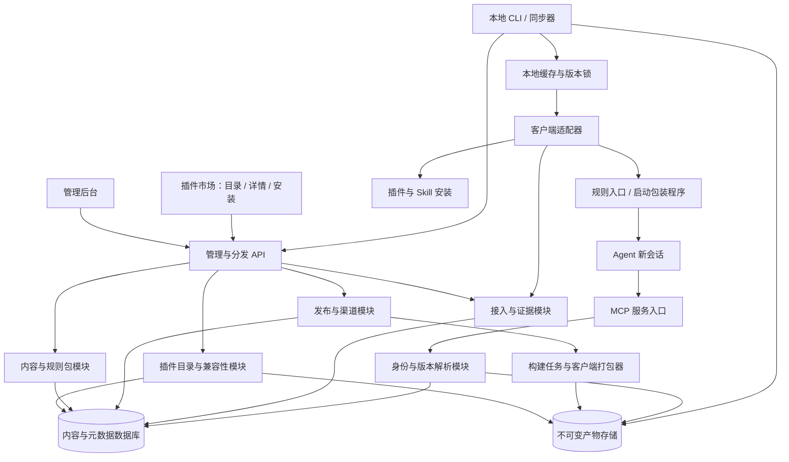

# Skill Hub 架构与实施方案

日期：2026-10-14
状态：架构方案，原型实施中；实际进度见 [实施记录](progress.md)
依据：[统一管理并发布 Agent 规则](thread://01a13939-1979-7792-8b21-514bad3c5fb4?hostId=local)

## 1. 项目定位与关键决策

Skill Hub 将散落在 Codex、Kimi、ZCode 等客户端中的规范集中管理。管理对象包含公共 Rule、角色、Skill 及其脚本、模板和参考资料；发布对象是这些内容组成的规则包。

上一会话确定了插件市场和 MCP 两种产品模式。本方案将它们作为同一内容来源的两个分发渠道，并增加本地同步与客户端适配层，补齐“中央已发布”到“新会话已加载”的链路。

| 决策 | 方案 | 原因 |
|---|---|---|
| 服务结构 | 模块化单体 + 独立本地 CLI | 首版减少部署成本，模块边界为后续拆分保留空间 |
| 内容来源 | 平台内容库为唯一编辑来源；Git 用于导入、导出和源码追溯 | 避免平台和 Git 双向编辑产生冲突 |
| 发布单位 | Bundle 的不可变 Release | 规则、角色、Skill 依赖可以一起锁定 |
| 分发渠道 | 插件市场、MCP、本地适配部署 | 分别覆盖工作流资源、在线查询和必读规则入口 |
| 更新方式 | 本地同步器主动拉取；推送仅作为提前检查信号 | 更新失败可重试、校验和回退 |
| 会话策略 | 新会话解析渠道，取得 Release 后固定 | 避免任务中途改变协作规范 |
| 生效判定 | 安装、获取、注入、行为验证分别记录 | 下载或模型自报不能证明实际加载 |

Rule 是模型行为指令，不等同于客户端强制执行的权限策略。平台可以管理、分发和验证规则，但不能承诺模型在所有场景完全遵守。

## 2. 产品范围

首版面向个人与小团队，必须完成 Codex、Kimi、ZCode 三类客户端的接入及端到端验收。Claude Code 留作后续扩展。用户已确认 Kimi 指桌面应用，首版必须验证桌面形态并记录版本；Kimi Work 与 OpenClaw 的验证结果不能互相替代。三类客户端均须具备市场选包、安装、更新、回滚和新会话加载链路；不支持原生插件市场的客户端通过 Skill Hub 本地适配器完成安装。自动加载能力需实测，缺少入口是待解决的接入缺口，不能仅登记能力便算首版完成。

管理后台包含以下页面：

| 页面 | 核心操作 | 主要输出 |
|---|---|---|
| 规范库 | 编辑 Rule、角色、Skill；查看引用和历史 | 内容修订及变更差异 |
| 规则包 | 组合规范，设置适用项目和客户端 | 可发布的 Bundle 定义 |
| 插件市场 | 浏览、搜索、按客户端筛选、查看详情、安装与更新 | 插件目录与安装入口 |
| 发布中心 | 校验、构建、比较差异、发布、回滚 | Release 与渠道指向 |
| 接入中心 | 注册设备、查看能力、生成安装指引 | 客户端配置与连接状态 |
| 生效记录 | 比较发布、安装、会话使用版本 | 证据、失败原因与待处理事项 |

首版包含自建插件市场，默认私有使用；暂不包含付费交易、公开第三方投稿审核、复杂企业组织管理、任意第三方脚本远程执行、完整对话内容采集。企业托管配置和设备管理渠道作为后续扩展。

## 3. 系统架构



后台 API、MCP 入口和构建 Worker 首版共用代码库，可按进程分开运行。MCP 与插件读取同一 Release，避免两个渠道得到不同规则。

### 模块职责

| 模块 | 负责 | 边界 |
|---|---|---|
| Content | 内容修订、引用关系、适用范围 | 不直接写客户端目录 |
| Bundle | 组合规范、解析依赖、生成锁定清单 | 发布前必须锁定具体修订 |
| Release | 不可变版本、构建状态、渠道切换 | 已发布内容不能原地修改 |
| Builder | 规范展开、格式转换、插件打包 | 不执行上传 Skill 内的任意脚本 |
| Resolver | 根据身份、项目、渠道确定版本 | 解析结果必须返回具体 Release ID |
| Marketplace | 插件目录、搜索、详情、版本历史、兼容性与安装指引 | 目录可见性与产物下载均需授权 |
| Distribution | 市场清单与产物下载、MCP 内容查询 | 不将内容获取标记为会话注入 |
| Adapter | 探测、安装、诊断、会话入口集成 | 只操作其管理范围内的文件 |
| Evidence | 设备状态、加载证据、验证结果 | 按证据来源展示可信范围 |

## 4. 内容结构与数据模型

内容采用 Markdown 正文加结构化元数据。Rule 写约束与适用条件；角色写职责与交付要求；Skill 写流程及资源引用。项目业务要求留在项目中，平台公共规范不得静默覆盖项目规则。

建议 Rule 元数据：

```yaml
id: collaboration.confirmation
kind: rule
title: 确认后的执行规则
scope: user
tags: [collaboration]
applies_to: [coding, writing]
```

正文可以表达“用户确认目标和步骤后，直接执行已确认范围内的工作”。元数据不使用自定义优先级宣称能够覆盖客户端系统指令；合成顺序与客户端真实指令优先级分别记录。

| 实体 | 关键字段 | 说明 |
|---|---|---|
| Namespace | id、name、owner | 首版单空间，保留归属边界 |
| ContentItem | id、kind、title、scope | 规范的稳定身份 |
| ContentRevision | item_id、revision_id、body、digest、resources | 每次保存生成修订，历史可追溯 |
| Bundle | id、name、composition | 规则包的编辑态定义 |
| Release | id、bundle_id、version、locked_revisions、manifest_digest | 锁定内容修订、资源和适配器版本 |
| PluginListing | id、bundle_id、name、description、visibility、supported_targets | 市场条目指向规则包，版本来自 Release |
| Artifact | release_id、target、digest、storage_key | 通用包及各客户端产物 |
| Channel | bundle_id、name、release_id、generation | stable / beta 指向与并发控制 |
| Assignment | subject、project_selector、bundle_id、channel_or_release | 指定身份、项目的分发策略 |
| Device / Installation | device_id、client_type、installed_release、capabilities | 已连接设备与本地安装状态 |
| SessionBinding | session_id、release_id、resolved_at、source | 会话版本锁 |
| Receipt / Verification | type、source、digest、result、timestamp | 获取、部署、注入及行为检查证据 |
| AuditEvent | actor、action、object、before、after | 发布、回滚与权限变更记录 |

一个会话可以使用多个包，SessionBinding 保存完整的 Release 集合及组合摘要。MVP 默认只分配一个主 Bundle，避免过早引入复杂组合。

## 5. 发布、回滚与一致性


Release 构建状态与渠道状态分开：创建、构建中、就绪、失败属于 Release；beta、stable 属于独立渠道指针。正式发布时，必需目标产物必须全部就绪，目标清单与渠道指针在一次数据库事务中切换。

发布校验包含缺失引用、依赖循环、重复 ID、非法资源路径、目标入口大小限制以及已声明的冲突。静态检查不能证明不存在语义冲突，需要结合典型任务案例和人工审阅。验证结果绑定具体内容摘要和适配器版本。

版本建议使用语义化版本：纠错为 patch，兼容扩充为 minor，改变协作契约或删除入口为 major；最终由发布者结合实际影响决定。Release 额外保存内容摘要，避免只凭版本字符串判断一致性。

回滚只移动渠道到已验证的旧 Release，不修改历史产物。设备下一次同步部署该版本，新会话使用回滚后的版本；已有会话继续绑定原版本。发现危险脚本时可以撤销产物并阻止后续执行，但无法撤回已经进入模型上下文的文本。

首版按设备主动拉取实现最终一致性，后台明确展示待更新设备。离线设备不能承诺立即更新。

## 6. 两种分发模式

### 插件市场模式

Builder 根据各客户端格式生成独立插件产物，包含 Skill、角色映射、资源，以及客户端实际支持的配置。发布中心将就绪版本上架到 Skill Hub 插件市场，市场提供目录、详情、版本历史与安装入口。正式接入前用官方格式和本机加载结果验证，不假定所有客户端都支持同一市场协议。

市场首版包含：

- 插件列表：搜索、标签、按 Codex / Kimi / ZCode 筛选。
- 详情页：内容组成、发布者、版本差异、兼容性、加载方式、资源及脚本权限说明。
- 安装流程：选择设备和客户端，选择跟随 stable 或固定 Release，交由原生安装器或本地适配器安装。
- 已安装页面：查看当前版本、可用更新、安装结果和会话加载证据，执行更新、回滚、卸载。
- 上架与下架：只有校验通过的产物可上架；下架阻止新增安装，保留历史版本与回执。

市场条目统一展示同一规则包，各客户端下载对应产物。不支持原生市场协议时，通过 `skillhub install <plugin-id> --client <codex|kimi|zcode>` 完成适配安装；不得将通用下载包展示为已验证的原生插件。更新策略由原生能力或同步器执行，市场页面仅负责配置与状态展示。

核心 Rule 的加载由适配器单独负责：通过受支持的规则文件或启动机制进入会话。安装插件或 Skill 仅证明资源可用，不能证明核心 Rule 自动加载。优先复用原生安装器；无法受控更新的客户端显示手动更新状态。

### MCP 模式

建议暴露以下能力，最终协议映射在实现阶段验证：

| 接口 | 用途 |
|---|---|
| `resolve_bundle` | 将渠道解析为不可变 Release，返回摘要与适用范围 |
| `get_bundle` | 按 Release ID 获取规则及索引 |
| `get_content` | 按 Release ID 与内容 ID 读取角色、Skill、参考材料 |
| `get_release_diff` | 比较版本，解释升级影响 |
| `report_receipt` | 记录客户端获取或加载声明，并注明来源 |

可提供 `skillhub://releases/{release_id}/manifest` 和内容资源 URI，以及手动加载规则包的 Prompt。所有正文读取都以确定的 Release ID 为准；运行中禁止反复查询 stable 后混入新旧内容。

MCP 提供内容获取途径，自动获取和注入仍需客户端入口。Skill 脚本采用签名产物下载和本地受控安装；MCP 返回文本不会自动安装脚本。首版不提供任意脚本执行工具。

## 7. 本地同步器与会话加载

建议命令接口：

```text
skillhub login
skillhub connect --client codex --bundle personal
skillhub install personal --client codex
skillhub install personal --client kimi
skillhub install personal --client zcode
skillhub sync --client codex
skillhub doctor --all
skillhub run --client <supported-client> -- <client-arguments>
skillhub rollback --client codex --release <release-id>
```

CLI 接口是待实现设计。`run` 只对支持启动包装程序的客户端开放，桌面“新对话”按钮是否经过该入口必须单独验证。

同步步骤：解析分配策略 → 获取 Release 清单 → 下载临时目录 → 校验摘要和发布签名 → 探测覆盖与冲突 → 备份管理范围内文件 → 安装 → 原子切换本地有效版本 → 记录安装回执。并发同步使用设备锁；中断后从日志恢复，不把部分安装标成成功。

多目录部署不能依靠一次 rename 获得全局原子性。适配器必须先完整准备资源，再最后切换入口；失败时按事务日志恢复已改文件。客户端不支持此策略时，提示需要重载，并保留安装未完成状态。

建议本地结构：

```text
~/.skillhub/
  config.json
  cache/releases/<release-id>/
  installations/<client-id>/state.json
  sessions/<binding-id>.json
  backups/<transaction-id>/
  receipts/pending/
```

核心 Rule 尽量直接进入自动加载入口，长内容按需读取。同步器只更新带管理标识的区块或独立托管文件。现有用户规则无法安全合并时生成可审阅差异，并阻止覆盖。诊断检查路径、覆盖文件、摘要漂移、入口大小和客户端重载需求。

离线默认使用最后一个完整且校验通过的版本，并记录缓存来源和时间；首次启动没有缓存则明确显示未加载，不伪造成功。安全要求较高的项目可配置禁止使用过期缓存，但首版不默认阻断正常工作。

### 会话版本固定的前提

包装程序可先解析 Release，并将规则与资源路径固定到该 Release。对只能读取全局规则文件、没有会话 Hook 的桌面客户端，先验证更新何时被读取、旧会话是否会重读文件。核心规则快照与运行中按需读取的 Skill 资源都必须考虑。

无法保留每会话资源快照时，界面应显示“核心规则加载已验证，动态资源版本固定未验证”；不能宣称整个会话完整固定版本。

## 8. 适配器能力与证据

每个适配器实现 `probe`、`build`、`install`、`doctor`，并根据实际能力选择 `bind_session`、`collect_evidence`。能力包括自动入口、启动 Hook、重载、原生插件、MCP、会话日志证据和离线缓存。

| 客户端 | 首版接入研究方向 | 当前方案状态 |
|---|---|---|
| Codex | 市场安装、规则入口、插件格式、覆盖与加载日志 | 首版必需，待本机验证 |
| Kimi 桌面应用 | 验证个人插件市场、规则入口与会话初始化，不沿用 Code CLI 结果 | 首版必需，待本机验证 |
| ZCode | 市场适配安装、现有规则、agents、skills 路径与启动加载链路 | 首版必需，待本机验证 |
| Claude Code | 原生插件与规则入口 | 后续扩展 |

状态展示采用并列证据：

| 证据 | 可以说明什么 |
|---|---|
| 发布清单 | 中央当前正式版本 |
| 文件摘要与安装回执 | 本地文件已部署 |
| MCP 获取日志 | 内容已被请求并返回 |
| 客户端可审计的注入记录 | 对应内容进入了会话入口 |
| 模型自报 | 仅为模型声明 |
| 行为案例结果 | 特定场景下规则得到遵循 |

没有客户端注入证据时显示未知或未验证。客户端上报也不等于远程证明，需记录来源和认证方式。日志只收集版本、摘要、时间、错误与必要证据片段，默认不上传完整对话。

## 9. 技术选型与代码组织

项目已初始化 Git 并实现 PostgreSQL 实体存储与 JSON 后备；HTTP/MCP 服务端已整合，以下选型保留完整产品目标，实际进度见实施记录。以下是供实现采用的默认技术建议，不代表现有依赖或已核实的客户端能力。

| 部分 | 建议 |
|---|---|
| 管理端 | React + TypeScript |
| 服务端与 MCP | TypeScript，HTTP API 与 MCP 共用业务模块 |
| 数据存储 | PostgreSQL；开发阶段可通过容器运行 |
| 产物 | 开发阶段本地目录，部署阶段兼容对象存储 |
| 构建任务 | 数据库任务表 + Worker，先不引入专用队列 |
| 本地同步器 | TypeScript CLI，后续依据分发成本评估独立二进制 |
| 部署 | 容器化单机部署，后台、API、Worker 可分进程 |

具体框架、MCP SDK、包版本在编码前查询官方文档确定；本方案不锁定未经验证的版本。

```text
skill_hub/
  apps/web/                 # 管理后台与插件市场
  apps/server/              # HTTP 与 MCP 入口
  apps/worker/              # 构建任务
  apps/cli/                 # 本地同步与诊断
  packages/domain/          # 内容、版本、分配与证据模型
  packages/contracts/       # API、清单和事件结构
  packages/compiler/        # 依赖解析与内容展开
  packages/adapters/        # 各客户端构建与部署实现
  packages/security/        # 摘要、签名和路径校验
  examples/                 # 首版规则包与验收场景
  tests/integration/        # 发布与本地安装集成验证
  docs/
```

管理 API 建议提供内容修订、Bundle、Release 构建、渠道切换、分配策略、设备状态与回执接口。分发接口与管理接口分权：设备仅可读取已分配产物和提交自身回执，不能编辑规则或发布。

渠道切换使用 generation 做比较更新，避免并发发布覆盖。构建、发布及回执提交支持幂等键；大产物通过受控下载地址传输。对外契约以共享 Schema 验证，防止客户端与服务端结构漂移。

## 10. 安全与运维边界

账号具有查看、编辑、发布、管理四类权限，首版允许同一用户拥有全部权限。设备令牌按设备与分配范围授权，可撤销；令牌存储使用系统凭据机制，日志不记录密钥。

产物发布时生成摘要并签名，本地校验信任的发布公钥；密钥轮换保留必要的旧版本验证能力。禁止资源路径穿越和越界符号链接。上传 Skill 的代码视为待执行代码，静态检查通过不代表安全；安装和执行应遵守客户端权限及用户已授权范围。

备份数据库、产物和渠道历史，并实际验证恢复流程。运行指标包含构建失败率、同步失败率、版本滞后设备数、加载证据覆盖率。每个错误提供错误码、发生阶段和建议处理动作。

## 11. 实施顺序与完成标准

任务级拆解见 [首版任务与执行计划](tasks-and-plan.md)，包含 T01–T29、依赖与验收矩阵。

按交付物推进，不预设尚无团队与工期依据的时间承诺。

| 阶段 | 交付物 | 完成标准 |
|---|---|---|
| P0 接入验证 | Codex、Kimi、ZCode 三类客户端能力报告、最小规则样例 | 确认 Kimi 具体形态及三类客户端的真实入口、更新时点和证据来源，形成接入实现计划 |
| P1 内容与版本 | 内容库、Bundle、锁定清单、不可变 Release | 同一修订输入得到可复现正文和摘要；修改草稿不影响已发布版本 |
| P2 发布与本地同步 | 产物下载、CLI、安装事务、诊断、回滚 | 一类客户端完成更新、失败恢复和新会话加载验证 |
| P3 双渠道与后台 | 三类完整适配器、插件市场、MCP、六个产品页面 | 三类客户端均可从市场安装、更新和加载；市场与 MCP 指向同一 Release；界面准确区分证据状态 |
| P4 稳定性与扩展 | 离线、并发、恢复测试及其他客户端能力档案 | 首版验收完成，再决定企业下发和更多客户端适配 |

首版用一次协作规则调整完成如下验收：

1. 发布 v1.0.0，Codex、Kimi、ZCode 三类客户端的新会话获得对应规则与内容摘要。
2. 修改草稿并发布 v1.1.0，新会话使用新版本，旧会话及按需资源符合已声明的固定能力。
3. 在 MCP 中读取旧会话绑定的 Release，不受 stable 更新影响。
4. 下载损坏或安装中断时，不进入半安装成功状态；原版本可恢复。
5. 断网时使用完整缓存并显示实际版本；无缓存时显示未加载。
6. 回滚 stable 后，新会话采用旧版本，历史会话记录仍可追溯。
7. 手工改动托管文件可被 doctor 检测，用户自行维护的规则得到保留。
8. 只有获取回执或模型自报时，不显示“已验证注入”。
9. 三类客户端均完成市场浏览、选包、安装、更新、回滚与卸载；兼容性和加载方式展示准确。
10. 通过“确认后执行”“按要求精简”“方案不扩展为部署”等代表场景验证行为，保留失败结果。

当前文档交付完成不代表上述验收已完成。下一步应从 P0 开始，用最小样例验证客户端入口，再据此确定适配器实现，避免先完成后台却无法证明规则生效。
